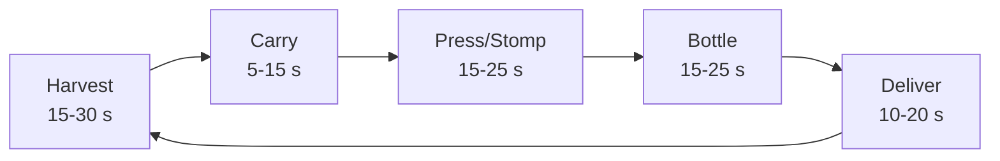

# Corked! — Game Design Document

| | |
|---|---|
| **Team** | Godly Games |
| **Members & roles** | Fredrik Hangaard (Bear) · Espen Gamst (Wolf) · Jesper Storm Halvorsen (Rabbit) · Lukas Veidahl (Cat) · Sverre Mæhlum (Owl) · Tobias Larsen (Puppy) |
| **Engine / platform** | Godot 4.7.2 Stable
| **Repo** | [imt3603/](https://github.com/Svemeh/imt3603/) |
| **Doc version** | v0.1 |
| **Last updated** | 2026-11-13 |

## Changelog

> Newest first. One line per meaningful design change. Markers and returning teammates read this first

| Version | Date | Change | Who |
|---|---|---|---|
| v0.1 | YYYY-MM-DD | Initial page one | @name |

---

# 1. Page One — The Core

> sec.1 is mandatory, always current, and should fit on roughly one page. If sec.1 and the build disagree, one of them is
> wrong — fix one within the week.

## 1.1 Hook

A chaotic co-op game about making the perfect bottle of wine. Corked! is a friend-slop game where you and your friends run a small Italian vineyard together, turning grapes into bottled wine through a hands-on production process. Harvest, carry, stomp, press, bottle, and deliver while trying to keep the whole operation running. Everyone has something to do, everyone depends on someone else, and when one person falls behind, the whole vineyard starts falling apart. Making wine is the goal, but the real fun is the chaos you create together while trying to get there.

## 1.2 Design pillars

> Exactly three. Pillars are **decision filters, not slogans** — each comes with consequences (things it forbids or
> forces). Every feature in this document must serve at least one pillar or it gets cut, however cool it is.

| Pillar | What it means | Consequences (what it forbids/forces) |
|---|---|---|
| 1. The chain is only as strong as its weakest link | Every stage — pick, sort, press, ferment, bottle — is mandatory. Players repeatedly depend on each other, shared work creates chaos. One station stalling stalls the next part of the chain. Promotes teamplay | Avoids making any part of the game loop feel inconsequential |
| 2. One vineyard that grows / changes | The map is set in stone, you can upgrade and plant more on the farm but not expand the size or move to a new farm | Avoids content creep|
| 3. Intuitive mechanics | All mechanics should be simple enough and conveyed to the user in a way that makes it obvious what the course of action should be | Avoids steering the game in a direction where individual tasks take more focus than the whole picture|

## 1.3 Core loop

> Draw it (embed an image or a Mermaid diagram) and **time it**. If you cannot put timings on it, you have not designed
> it yet.

- **Moment loop (seconds):** One grape's full serial journey through the chain is **60-115 s** (sum of all five stations), this does not account for actual travel time and if teammates sabotage the player. That number is *not* the throughput a table of 3-4 players actually feels, though with 5 stations and 3-4 players, someone is always covering more than one station, and stages run in parallel once the pipeline is full. Once running, a new bottle should complete roughly every **20-30 s**, gated by whichever station is currently the bottleneck (pillar 1: the chain is only as strong as its weakest link, a stalled station is what the player *feels*, not the 60-115 s total)
- **Session loop (minutes):** A meaningful session lasts **5-10 minutes**. A single delivery "round" against one order. At a ~20-30 s/bottle throughput once the gameplay loop is warm, that's roughly **8-15 bottles** possible if the table runs clean, so a round's order target should sit under that ceiling (e.g. 6-10 bottles) to leave room for the pipeline-fill time at the start and the chaos/mistakes pillar 1 exists to create. [Confirm the exact order size against sec.11 playtesting.]
- **Meta loop (hours):** Across sessions, deliveries earn currency spent on vineyard upgrades. Faster or additional stations (a second press, a bigger cart for Carry, more harvest plots), which raises next session's per-station and throughput numbers. This is the "grows" half of pillar 2: the vineyard's footprint stays fixed, but its stations get faster/more numerous, which is what should make session 10 feel different from session 1.

## 1.4 Audience & genre

> Who plays this, what do they play now, what will they recognise, and what will surprise them? "Everyone" is not an
> audience. Name two or three comparison games and what you take from each and reject from each.

Our targeted audience are groups of friends from 2-4 players. The game is about cooperation and is a topdown game, similar to "plateUp!", where 2-4 players run around on a small map to complete tasks in order to satisfy their customers. 
Our audience play games like: PlateUp, PEAK, How To Fish - or any other friendslop game about cooperating with eachother and chaotic games. Anyone can play these games and join in on the fun, every type of player will find something to do along the loop. They will recognise the chaos, fun, immersive and stressful gameplay "corked!" has to offer. Even though they operate on the same theme, our game differentiates by the core mehcanics of the game that consists of equipment can break down, weather can slow down progress, pests can trample on crops, or players can bump into eachother so hard that their carried items can be dropped.

| Game | Take  | Reject |
|---|---|---|
|PlateUp!| Art style | cooking mechanism|
||  Day/Year sycle | Money Making Method|
| How To Fish | Coop | 3D artstyle |  
| Peak  | Ragdolly, physics | objective |      |

## 1.5 Look, feel, and tone — in one paragraph

Corked! uses a warm, saturated and stylised 3D-like interpretation of an Italian vineyard. The environment combines sunlit stone buildings, terracotta roofs, wooden barrels, grape-purple accents, green vines/flowers and warm yellow/orange lighting. Shapes are rounded, clean, and readable rather than sharp and detailed. The camera uses a slightly tilted top-down 3D perspective, combining the readability of *PlateUp!* with enough depth for physical interactions, ragdolls, vehicles and other environmental comedy. The vineyard should feel simple, cosy, warm and inviting while production becomes increasingly stressful and chaotic. 

Core palette: terracotta orange · warm yellow · grape purple · olive/vine green · warm stone · dark wood.

## 1.6 Scope: goals and non-goals

### Non-goals

> The most valuable sentences in a student GDD usually start with "No". Non-goals are decisions too — written down so
> they stay decided and do not get re-litigated every week. Move cut features here with a changelog note.

- **No open world.** The game will take place on one vineyard and winery instead of having several large areas to travel between.
- **No fully realistic wine simulation.** We want to show the main steps of making wine, but we do not need to include every real-life detail.
- **No large number of wine types or locations.** For this project, we will focus on red wine and an Italian-inspired vineyard. Other wine types and locations can be ideas for later.
- **No overly complicated mechanics.** Interactions should be fun and physical, but still easy for players to understand.
- **No gameplay where everyone can just work alone.** The game should encourage players to cooperate and depend on each other.
- **No travelling to other locations to collect or buy resources.** The main gameplay should stay focused on the vineyard and the wine-making process.
- **No major vineyard expansion.** If we add expansion, it should mainly be about unlocking or improving parts of the vineyard we already have.
- **No large amount of random events in the vertical slice.** Things like fires, broken machines, birds damaging crops, or tractor problems can be added later if there is enough time.
- **No drunk mode as an important feature for this semester.**
- **No chaos just for the sake of chaos.** The game can be stressful and messy, but players should still understand what they are supposed to do.

### MoSCoW scope table

> **Must** = the game is not this game without it (this is your vertical slice). **Should** = ships if the Musts land.
> **Could** = first against the wall when you are late. **Won't** = not this semester; belongs in non-goals.
> Every row needs an owner.

- 

| Feature | Priority | Milestone | Owner | Status |
| --- | --- | --- | --- | --- |
| Cooperative multiplayer for 2+ players | Must |  | - | Not started |
| Top-down / high-angle 3D player movement and interaction | Must |  | - | Not started |
| Harvest grapes from vineyard | Must |  | - | Not started |
| Pick up, carry and transfer grapes/resources between production stations | Must |  | - | Not started |
| Physical grape crushing / pressing interaction | Must |  | - | Not started |
| Basic wine-processing station. | Must |  | - | Not started |
| Bottling interaction | Must |  | - | Not started |
| Deliver / Sell completed wine | Must |  | - | Not started |
| Production quota / round objective | Must |  | - | Not started |
| Approx. 5 minute production-day/session structure | Must |  | - | Not started |
| Clear visual communication of interactive stations and items | Must |  | - | Not started |
| Warm stylised italian vineyard environment | Must |  | - | Not started |
| Money/Reward from completed production | Should |  | - | Not started |
| increasing quotas / difficulty across production days | Should |  | - | Not started |
| Equipment / station uppgrades | Should |  | - | Not started |
| Tasks where multiple players can cooperate to work faster or move objects | Should |  | - | Not started |
| Short contextual onboarding/tutorial prompts | Should |  | - | Not started |
| Bonus reward for producing beyond the quota | Should |  | - | Not started |
| Difficulty options affecting time and/or quota | Could |  | - | Not started |
| Equipment breakdowns and temporary emergencies | Could |  | - | Not started |
| Crop disruptions such as birds damaging grape bushes | Could |  | - | Not started |
| Unlockable/expanded areas within the vineyard | Could |  | - | Not started |
| Exaggerated ragdoll / physics-based comedy and polish | Could |  | - | Not started |
| Additional vineyard regions or wine types | Won’t |  | - | Not started |
| Open-world travel between vineyards | Won’t |  | - | Not started |
| Fully realistic wine-production simulation | Won’t |  | - | Not started |
| Drunk gameplay mode | Won’t |  | - | Not started |

---

# 2. Gameplay & Mechanics — owner: Tobias

> **Prose rules for every module:** numbers, units, and defaults ("fast" is an opinion; "6 m/s" is a decision — wrong
> numbers are fine, they are testable; missing numbers are not). One idea per paragraph, decision first, reason second.
> Diagrams over paragraphs for anything spatial or temporal. Pick one term per concept ("stamina" *or* "energy") and use
> it everywhere. "Etc." is a scope bug, not a word.

## **2.1 Player verbs & controls**

| **Verb** | **Input** | **Timing / numbers** | **Notes** |
| --- | --- | --- | --- |
| Move | left stick / WASD | max 4 m/s | This is constant throughout the game, doesn’t change at any point |
| Jump | Not possible | No time since not possible | We never considered jumping for the game, since it doesn’t really match the top down couch play estetic. |
| Run | Shift and WASD / L1 + Left Stick | max 7 m/s, changes when with spills, cant run on them | Run time is the same throughout the game except if you crash into a player, or run on a wine spill. In these cases the player will fall. |
| Pick up Item | K / X | max 0.1 s or Instant | Player picks up an item, items include barrel, grape, hammer, item and wine crate. |
| Interact with Interactable | J / Square | max 0.1 s or Instant | Used when on a interactable stations and during minigames. |
| Clicking | Mouse / X | max 0.1 s or Instant | Only used in the different menu’s. Main menu, next round, game over etc. |

## **2.2 Systems & rules (the model of the world)**

> This is the simulation your game runs on — the implicit and explicit rules, and how the pieces interact. One subsection per system, each stating: intent (which pillar it serves), the rules with numbers, the states and transitions (draw the state machine), and edge cases — especially *"what happens if the player just… doesn't?"*
> 

### 2.2.1 Production Chain

- **Intent:** Pillar 1, *the chain is only as strong as its weakest link*. Every station is mandatory, and each one depends on the one before it. A stalled station stalls everything after it, which pushes players to coordinate and cover for each other.
- **Rules:**
    - The chain is: **Harvest → Stomp → Ferment → Bottle → Crate table → Deliver**.
    - Units move through the chain 1:1:
        - 1 grape → 1 juice unit (stomping)
        - 4 juice units → 4 wine units (fermentation)
        - 1 wine unit → 1 bottle (bottling)
    - A barrel holds **4 units**. It’s filled with juice at the stomping station, turned to wine at the fermentation station and emptied into bottles at the bottling station. An empty barrel is reused.
    - A crate holds **4 bottles**. A crate with **1 or more** bottles can be carried and delivered, so a quota that isn’t a multiple of 4 (for example 13) can still be met exactly.
    - Items are moved between stations by hand (see 2.2.6).
- **States (barrel):** Empty → Juice (1–4) → Fermenting → Wine (4) → Bottling (4 → 0) → Empty
- **Edge cases:**
    - *Nobody runs a station:* everything after it stops. No bottles means the quota is missed.
    - *A barrel is taken from a station mid-process:*  the station resets its progress (stomping progress or bottling). The barrel keeps its units.
    - *A barrel is only partly filled:* it can still be fermented and bottled, but gives fewer bottles.
    - Failing in the minigame can make you loose all, or some of the wine in the barrel. That depends on how the player does in the minigame.

### 2.2.2 Harvesting

- **Intent:** Pillar 1. The start of the chain, a steady supply job that someone has to keep doing. Pillar 3: walk to a vine and press a button.
- **Rules:**
    - Interact (J) with a grapevine to pick grapes. The player can pick up 1 grape per 5 seconds from one specific vine.
    - Each grape has an amount of **1** juice unit.
    - Grapes are carried by hand (one at a time) to the stomping station, which holds up to **4** grapes at once.
    - Vines regrow after 5 seconds.
- **States (vine):** Ripe → Picked → Regrowing → Ripe → Picked, and so on.
- **Edge cases:**
    - *Nobody harvests:* the stomping station runs dry and the whole chain stops.
    - *Too many grapes are picked:* loose grapes lie on the ground until someone carries them. The stomping station refuses more than 4.

#### 2.2.3 Stomping Station (minigame)

- **Intent:** Pillar 1 (a link in the chain) and pillar 3 (just press one button). It adds physical, frantic action that keeps a player busy, and sets up the “chaos” moments.
- **Rules:**
    - The station needs **a barrel docked** and **at least one grape** loaded (up to 4).
    - Each press of interact (J) = **+1 stomp**. A grape is done after **10 stomps** (stomps_required).
    - Progress drains by **0.1 stomp every 0.1 s** (decay_per_tick, decay_interval), about **1 stomp per second**. Players need to press faster than that to finish a grape.
    - A finished grape adds its juice (**1 unit**) to the barrel, up to the barrel’s max of **4**, and the next grape starts from 0.
    - Popup: the MASH bar goes red → yellow → green with progress, the JUICE bar shows how full the barrel is, and the L/R feet alternate on every stomp. A wet stomp sound plays on each press.
- **States:** Idle (no grape or no barrel) → Stomping (0–10) → Grape done → Stomping / Idle
Barrel full (4/4): stomping stops until the barrel is taken away.
- **Edge cases:**
    - *The player stops pressing:*  progress drains back to 0, so the work is lost but nothing breaks.
    - *The barrel is taken mid-grape:*  stomp progress resets to 0. The grape stays in the press.
    - *Several players stomp at once:*  their presses add up, so co-operation finishes faster.
    - *The barrel is full:*  J does nothing until someone swaps the barrel.

#### 2.2.4 Fermentation Station (minigame)

- **Intent:** Pillar 1 (the slowest link, which needs attention) and pillar 3 (hit the marked parts of the circle). It creates “chaos” (Lukas, 23.10.2026), because someone has to stay and babysit the pressure on the minigame.
- **Rules:**
    - Dock a barrel of juice. Fermentation starts. The barrel doesn’t need to be full to dock it.
    - A pressure gauge has three zones:
        - **Green:** fermentation runs at normal speed.
        - **Yellow:** fermentation is paused.
        - **Red:** paused and one unit of juice lost every red_loss_time.
    - A needle moves around a circular gauge. pressing J while the nieedle is in a marked zone keeps the pressure in green.
    - Fermentation takes. When done, the barrel holds wine (**4/4**) and can be picked up. The popup shows “WINE 4/4” and “BARREL”.
    - The barrel can be picked up while fermenting (can_pick_up = true).
- **States:** Empty → Barrel docked → Fermenting (green/yellow/red) → Done (wine) → Empty
Red → Lost wine depending on how baddly the player did
- **Edge cases:**
    - *Nobody watches the gauge:*  pressure drifts into red and the batch is lost. **[check]**
    - *Someone tries to take the barrel mid-fermentation:*  it’s removed and stops the minigame.
    - *The barrel is never picked up after it’s done:*  the next barrel can’t be docked, so the chain stalls.
    - *Stays in yellow zone:* the juice is always paused and doesn’t get fermented

#### 2.2.5 Bottling Station breakdowns

- **Intent:** Pillar 1 (a broken link stops delivery) and pillar 3 (a red popup and a hammer). It forces the player or a second player to leave what they’re doing and fetch the tool.
- **Rules:**
    - Dock a barrel of wine with interact2 (K). Each press of interact (J) fills one bottle (1 wine unit), which travels down the conveyor, gets capped and lands in the crate.
    - After each bottle, the machine breaks with a **5 %** chance (base_break_chance). Each bottle that *doesn’t* break it adds **+5 %** (break_chance_step), and the chance resets to 5 % after a breakdown.
    - A broken machine can’t bottle. A popup appears above it with a **red** ball.
    - It’s fixed with **4 hits** (hits_to_fix): interact (J) while **holding the hammer**. Each hit moves the ball from red towards green.
    - A player holding the hammer can’t bottle; they have to put it down first.
    - **The hammer** starts on a shelf in the utility room. It can **only** be put down on that shelf (interact2); it can’t be dropped anywhere else.
    - The crate can be taken at **1–4 bottles**, except while a bottle is on its way. A new empty crate then appears.
- **States:** Idle → Bottling → Idle (no breakdown) / Broken → Repairing (hits 1–3) → Idle (4th hit)
- **Edge cases:**
    - *Nobody fixes it:*  bottling stops for the rest of the round. The popup stays visible (is_running( )) so players notice even when they’re away.
    - *The hammer is being carried elsewhere:*  only one hammer exists and it can’t be dropped, so whoever holds it controls repairs. That’s intended chaos.
    - *It breaks with a bottle mid-conveyor-ride:*  it can’t. The roll only happens after a bottle has landed.
    - *The barrel is empty:*  it turns back into a normal barrel and is taken back with K for reuse.

#### 2.2.6 Carrying and item rules

- **Intent:** Pillar 3. Two buttons with clear jobs: **interact2 (K) handles items**, **interact (J) uses stations**.
- **Rules:**
    - Each player carries **one item** at a time.
    - K with empty hands picks up the nearest loose item, within about **1 m** in front of the player.
    - K while holding an item hands it to the nearest station that accepts it. If none does, it drops the item on the floor.
    - Exceptions: the **hammer** (only on its shelf) and **crates** (only on the crate table or into the open truck) can’t be dropped.
    - Some items are locked in place and can’t be picked up:  a crate while a bottle is being added, crates loaded in the truck.
- **Edge cases:**
    - *The crate table is full and the truck is closed:*  a player holding a crate can’t put it down until there’s room.
    - *A station is too far into a wall to reach its item:*  the item has to sit within reach of where players can stand (level design rule).

#### 2.2.7 Crate table and delivery truck

- **Intent:** Pillar 1 (the last link) and pillar 2 (one fixed vineyard). It gives the round a climax: the team has to decide **together** when to send the truck.
- **Rules:**
    - During most of the round the driver is on a **smoke break**: the truck doors are closed and nothing can be loaded.
    - Finished crates (1+ bottles) are stored on the **crate table**, which has 4 spots, this will be changed since it needs to be bigger.
    - When **75 %** of the round has passed (delivery_opens_at, measured against round_duration), the driver comes back and the doors open.
    - Crates are carried from the table and loaded into the truck with K. Loaded crates are locked in.
    - **Any** player can send the truck **once** with J at the driver. He walks to the cab, gets in, and the truck drives off.
    - Bottles in the truck ≥ quota means **the day is won**. Fewer means **the day is lost**, even if more crates were ready.
- **States (truck):** Closed (smoke break) → Open (loading) → Sent → Gone
- **Edge cases:**
    - *Someone sends the truck too early:*  the day is lost. That’s intentional (“your teammate can ruin the round”).
    - *Nobody sends the truck:*  time runs out and the day is lost.
    - *The truck is sent with an empty load:*  not possible, the driver only reacts when there’s at least one crate on board.

#### 2.2.8 Rounds, timer and quota

- **Intent:** Pillar 2 (the same vineyard, harder each day) and the session loop from 1.3 (5–10 minute rounds). This one might be changed a bit more along the way.
- **Rules:**
    - Each round (day) lasts round_duration = **360 s** (6 min) . A timer bar on the HUD shows time passed. (This is not fully decided yet, and will be optimized once the game is properrly tested with 4 players.
    - The quota starts at **8 bottles** (two crates), and grows by a random **5–10 bottles** after each won round.
    - **Won day:** money is earned (**10 per bottle**, see 2.6), the round transition screen is shown, then the next round starts.
    - **Lost day** (sent short, or time ran out): a game-over screen with a recap, and a new game has to be started, or the player can go to main menu.
    - Between rounds, **everything in the world is reset** (stations, items, truck), while money and stats carry over.
- **States:** Playing → Truck sent / Time out → Won (upgrade/skip screen → next round) or Lost (game over)
- **Edge cases:**
    - *The truck is sent in the last second and time runs out during the drive-off:* the timer stops when the truck is sent, so it can’t count as both a win and a loss.

#### 2.2.9 Player collision and spills

- **Intent:** The “chaos” part of the hook. Physical comedy, and a reason to be careful with what you carry.
- **Rules:**
    - Running into another player makes **both** drop what they’re holding and fall, unless both are walking.
    - A dropped barrel loses **2 juice** and leaves a spill. A dropped crate breaks. Spills make players slip. The broom removes spills and can be put down anywhere.
    - If a player walk over the spills they are fine, if they run over them they will fall the ground and the same drop rules count here.
- **Edge cases:**
    - *A player with the hammer is bumped:*  the hammer falls to the floor and tumbles. This is the only way it ends up off the shelf.
    - *Spills pile up:*  more of the map becomes risky to run across.

## **2.3 Movement & physics**

> Gravity, friction, collision behaviour, anything non-standard. If you use engine defaults, say so — that is a decision.
> 

#### 2.3.1 Physics engine

- **Engine:** Godot 4.7 with **Jolt Physics** (3d/physics_engine = “Jolt Physics” in project.godot). Jolt is used instead of Godot’s built-in physics because it’s more stable for many stacked or colliding rigid bodies (barrels, crates, grapes).
- **Gravity:** engine default.
- **Physics tick rate:** engine default, **60 Hz**.

#### 2.3.2 Player movement

The player is a `CharacterBody3D` moved with `move_and_slide()`. It is **not** physics-simulated: it moves exactly as the input says and slides along walls.

| Property | Value | Notes |
| --- | --- | --- |
| Walk speed | **4 m/s** | `walk_speed` |
| Run speed | **7 m/s** | `run_speed`, while holding Run |
| Acceleration | **25 m/s²** | from standing to walk speed in about 0.16 s |
| Deceleration | **45 m/s²** | stops quickly when input is released, for a snappy feel |
| Turn speed | **10** (lerp factor per second) | the player turns smoothly towards the direction of movement |
| Movement plane | X/Z only | input is flattened onto the ground, with no vertical movement or jumping |
| Gravity on player | **none** **[check]** | the floor is flat, so the player never leaves the ground |

**Why fast deceleration:** in a top-down co-op game, players need to stop exactly at a station. Slow stopping makes them overshoot stations and bump into each other by accident instead of on purpose.

#### 2.3.3 Collision layers

| Layer | Name | Used by |
| --- | --- | --- |
| 1 | world | walls, floor, station bodies, the truck |
| 2 | player | players |
| 3 | interactable | stations, the delivery zone, the driver, the crate table, the hammer shelf |
| 4 | carryable | items: grapes, barrels, crates, the hammer |
- Stations sit on layers **1 + 3**, so they’re solid **and** interactable.
- Items sit on layers **1 + 4**.
- Each player has an **interact area**: a sphere with a radius of **0.5 m**, placed **0.48 m** in front of the player at about knee height. It detects layers **3 and 4** only, so it finds stations and items but ignores walls and other players.
- **Level design rule that follows from this:** anything a player should pick up must sit within about **1 m** in front of where a player can stand, and low. An item tucked inside a station’s collision box or up on a high shelf can’t be reached.

#### 2.3.4 Items

Items are RigidBody3d’s, physics-simulated while lying loose on the ground.

- **Held items** are **frozen** (freeze = true) and follow the player’s hand marker. The player ignores collisions with the item it holds, so it doesn’t push itself.
- **Items placed in stations** (a barrel at a station, crates on the table or in the truck, the hammer on its shelf) are also frozen, and locked to a marker (Marker3d).
- **Dropped items** are unfrozen and fall and roll freely.
- **Hammer:** tuned so it tumbles instead of flying when bumped:
    - Mass **3 kg**, linear and angular damping **3**, friction **1**, bounce **0**
    - Ground speed is capped at **4 m/s**, and upward speed at **0.5 m/s**, so it can hop a little but never fly.
- **Wine crates** have gravity scale **0** and are frozen by default.
- **Rule: physics bodies are never scaled.** Bodies and collision shapes stay at scale 1, and only the visual model is scaled. Jolt resets the scale of rigid bodies, so a scaled body would change size when the game starts.

#### 2.3.5 Player collision and falling

- Running into another player makes **both** players drop what they’re holding and fall, unless both are walking. A fall lasts for 1 second
- Running over a wine spill makes the player fall, with the same drop rules. Walking over it is safe. After walking over the spill, you will have a walking debuff for 3 seconds before you can run again.
- A fallen player can’t move for 1 second.

#### 2.3.6 Engine defaults we keep

- Default **gravity** and **tick rate** (see 2.3.1).
- Default **friction** on everything except the hammer.
- Default move_and_slide() wall sliding for players.

## **2.4 Objects & interactions**

> What objects exist, how the player interacts with each, and what state each carries. A table beats prose here.
> 

Controls recap just for consistancy: K / interact2 handles items. J / interact uses stations. See 2.1 and 2.2.6.

#### 2.4.1 Items (carryable)

| Item | K (empty hands) | K (holding it) | J (holding it) | State it carries | Notes |
| --- | --- | --- | --- | --- | --- |
| **Grape** | Pick up | Load into the stomping station (max 4 grapes); otherwise drop on the floor | – | `amount` = 1 juice unit | Comes from a grapevine |
| **Barrel** | Pick up | Dock at the stomping, fermentation or bottling station if accepted; otherwise drop | – | `juice_amount` (0–4), `is_wine` (juice or wine), liquid level visual | Reused: empty after bottling, then back to stomping |
| **Wine crate** | Pick up (1+ bottles) | Put on the crate table, or load into the open truck. **Can’t be dropped** anywhere else | – | `bottles` (0–4), empty or full visual | Locked while a bottle is landing in it, and when loaded in the truck |
| **Hammer** | Pick up | Put back on the hammer shelf. **Can’t be dropped** anywhere else | Hit the broken bottling station (1 of 4 hits) | – | Only one exists. Starts on the shelf |
| **Broom** | Pick up | Put down anywhere | Cleans a wine spill | – | Cleans a wine spill after using it with j since the wine spill is an interactable |

#### 2.4.2 Stations and fixed objects

| Object | K (holding an item) | J | State it carries | Notes |
| --- | --- | --- | --- | --- |
| **Grapevine** | – | Pick a grape (1 per 5 s per vine) | Ripe / regrowing, regrow timer (5 s) |  |
| **Stomping station** | Grape: load (max 4). Barrel: dock (one at a time) | Stomp (+1 stomp, 10 per grape) | Grapes loaded (0–4), mash progress (0–10, drains), docked barrel | Popup: MASH bar, JUICE bar, L/R feet. Sound on each stomp |
| **Fermentation station** | Juice barrel: dock | Hit the marked zone to keep pressure in green | Docked barrel, pressure (green / yellow / red), fermentation progress | Popup: pressure gauge, WINE and BARREL bars. Red loses 1 unit every `red_loss_time` |
| **Bottling station** | Wine barrel: dock | Bottle one unit (needs a working machine and empty hands) / hit with hammer while broken | Docked barrel, current crate, busy (bottle on the conveyor), broken, break chance (5 % → +5 %), hits (0–4) | Popup: red → green ball while broken |
| **Hammer shelf** | Hammer: put back | – | Holds the hammer or is empty | Utility room. The only place the hammer can be put down |
| **Crate table** | Crate (1+ bottles): place in a free spot | – | Spots (4) **[planned: more]**, which crates are where | Utility room. Crates can be picked up again with K |
| **Delivery truck** (back doors) | Crate (1+ bottles): load, only when open | – | Open / closed, loaded crates, bottle count | Closed until 75 % of the round. Loaded crates are locked in |
| **Delivery driver** | – | Send the truck (once, only with crates on board) | On smoke break / back / sent | Walks to the cab, disappears, the truck drives off. Win/lose is decided |
| **Wine spill** | – | Comes after a wine crate or barrel falls on the ground. Use broom and J to clean the spill. | Exists / cleaned | Running over it makes the player fall. Walking is safe |

#### 2.4.3 Player ↔ player

| Situation | Result |
| --- | --- |
| One or both players **running** into each other | Both drop what they hold and fall |
| Both **walking** | Nothing happens; they just block each other |
| A player holding the **hammer** or a **crate** is knocked down | The player drops them . Hammer tubles, wine crate creates a spill |

#### 2.4.4 Interaction rules across all objects

- **Nearest wins:** when several stations or items are within reach, the **closest** one gets the K or J press.
- **Reach:** about **1 m** in front of the player, low (see 2.3.3).
- **One item per player.**
- **Stations check for themselves:** a station only reacts if its own rules allow it (e.g. the bottling station refuses a juice barrel; the truck refuses crates while closed). When nothing accepts an item on K, it’s dropped, except the hammer and crates, which stay in your hands.

## **2.5 Combat / conflict (if any)**

> Frame data, damage tables, health values, death and failure consequences. Windups, active frames, recovery, i-frames — numbers a programmer can type in today and a playtester can falsify tomorrow.
> 

#### 2.5.1 No combat

Corked! has **no combat**: no health, no damage, no enemies and no player death. This is a deliberate decision. The game is about co-operation (pillar 1), and its “enemies” are the clock, the machines and the team’s own coordination. Combat would pull players’ attention away from the production chain and against each other, which goes against the non-goal *“No gameplay where everyone can just work alone”* and pillar 3 (*intuitive mechanics*).

#### 2.5.2 What the players are up against instead

| Source of conflict | How it pressures the team | Numbers |
| --- | --- | --- |
| **The clock** | The round ends whether or not the quota is met | round_duration = 360 s; the truck opens at 75 % (270 s) |
| **The quota** | Rises every day, so the same team has to get faster | starts at 8 bottles, +5–10 per won day |
| **Stomping decay** | Progress is lost if nobody keeps stomping | −0.1 stomp every 0.1 s (≈ 1 stomp/s); 10 stomps per grape |
| **Fermentation pressure** | Leaving the gauge alone costs wine | yellow = paused; red = −1 unit every red_loss_time |
| **Bottling breakdowns** | The machine stops until someone fetches the hammer | 5 % chance after a bottle, +5 % per bottle, 4 hits to fix |
| **Smoke break** | Crates pile up on the table until 75 % of the round | table holds 4 crates, this is planned to be more |

#### 2.5.3 Player vs player (friendly chaos)

Players can’t hurt each other, but they **can get in each other’s way**:

| Event | Effect | Recovery |
| --- | --- | --- |
| **Bump** (one or both running) | Both drop what they hold and fall | Can’t move for 1 second, then pick the item back up, unless its a crate then its destroyed |
| **Slipping on a spill** | The player falls and drops what they hold. A barrel loses 2 units, a crate breaks | Same as a bump |
| **Hogging the hammer** | Repairs can’t happen while someone else carries it around | Only ends when the holder puts it back on the shelf (or is bumped) |
| **Sending the truck too early** | The whole day is lost | None: it’s final, and that’s the point (“your teammate can ruin the round”) |

#### 2.5.4 Failure and its consequences

There’s no death, but there are three levels of failure:

| Level | Example | Consequence |
| --- | --- | --- |
| **Small** | Stomp progress drains, a bump, a dropped grape | Lost seconds; redo the work |
| **Medium** | Fermentation in red, a bottling breakdown, a broken crate  | Lost wine or bottles; the chain stalls until fixed |
| **Final** | Truck sent short of quota, or time runs out | **Day lost**: game over screen with a recap; a new game has to be started |

A won day carries money and stats over to the next round. A lost day ends the run. There are **no lives or retries** within a run, which keeps every round tense.

## **2.6 Economy & resources (if any)**

> What resources does the player have? How are they earned? How are they spent? Why do they want more? Add sources, sinks, and starting values.
> 
> 
> **If real money is involved at any point, see sec.12.4 — monetisation is now a regulated design surface in the EU/EEA.**
> 

#### 2.6.1 Money (carries over between rounds)

|  |  |
| --- | --- |
| **Starting value** | **0** at the start of a new game |
| **Source** | Only a **won day**: **10 money per delivered bottle** (money_per_bottle), paid when the truck has driven off |
| **Bottles over quota** | Also paid at 10 each. Delivering more than the quota gives more money, which is a built-in bonus for over-delivering (GDD 1.6 “Should: bonus reward for producing beyond the quota”) |
| **Lost day** | **Nothing** is paid out, and the run ends (see 2.2.8) |
| **Sinks** | **None yet.** The upgrade screen between rounds exists but has no upgrades; players can only skip. **[planned: station upgrades, see 2.7]** |
| **Carried over** | Kept between rounds within a run. Reset to 0 when a new game is started |
| **Shown on** | The HUD (“Money: X”), the round transition screen and the game-over recap |

**Why players want more money:** right now it works as a **score**, showing how well the run went. Once upgrades/modifiers are added, it becomes the way to make the vineyard faster.

#### 2.6.2 Production resources (reset every round)

These exist only within a round. All of them are reset when the next round starts.

| Resource | Source | Sink / turns into | Limit |
| --- | --- | --- | --- |
| **Grapes** | Grapevines, 1 grape per 5 s per vine | Stomping, 1 grape → 1 juice unit | 4 in the stomping station at once |
| **Juice** | Stomping station | Fermentation, 1 juice → 1 wine | 4 per barrel |
| **Wine** | Fermentation station | Bottling, 1 wine → 1 bottle | 4 per barrel |
| **Bottles** | Bottling station | Crates, then the truck, then counted against the quota | 4 per crate |
| **Barrels** | Fixed number in the barrel room **[check: how many]** | Never used up; reused after bottling | – |
| **Crates** | A new empty crate appears at the bottling station each time one is taken | Delivered (removed after the truck leaves) | Table holds 4, planned for more |
| **Hammer** | Exactly **1**, starts on the shelf | Never used up | – |
| **Time** | round_duration = 360 s per round | The only resource that **can’t** be produced, so it’s the real limit on the economy | Subject to change after optimization testing |

Losses: spills and dropped crates are the main sink inside a round. A dropped barrel loses 2 units of whatever liquid it contains, a dropped crate breaks with all its bottles, and fermentation in red loses 1 unit every red_loss_time.

#### 2.6.3 Balance (rough)

- Once the chain is running, a full barrel gives **4 bottles = 40 money**, if the day is won.
- The first quota (8 bottles) needs **2 barrels** through the whole chain within 360 s, with the truck only open for the last **90 s**.
- Each won day adds **5–10 bottles** to the quota, which is 2–3 extra barrels. Without upgrades, the team has to get faster every day, which is why money sinks (upgrades/modifiers) matter for the long run.

#### 2.6.4 Real money

**None.** Corked! has no purchases, ads or randomised paid rewards. Money exists only inside the game. Section 12.4 doesn’t apply.

## **2.7 Progression & difficulty**

> How does the player progress, and *how do they know* they are progressing? Challenge hierarchy, puzzle structure, unlock order, difficulty curve. Difficulty options are design — see sec.7.
> 

#### 2.7.1 How players progress

A run is a series of **days** (rounds). Every won day moves the team to the next, harder day. A lost day ends the run.

| Layer | What progresses | Kept between days? |
| --- | --- | --- |
| **Day number** | +1 per won day | Yes, within a run |
| **Quota** | Rises after every won day (2.7.3) | Yes, within a run |
| **Money** | +10 per delivered bottle on a won day | Yes, within a run |
| **Run stats** | Bottles sold, money earned, days survived | Yes; shown on the recap |
| **The world** | Stations, items, truck | **No**: everything is reset each day |
| **Player skill** | The team’s coordination and routines | Yes, and that’s the main “progression” in the game today |

#### 2.7.2 How players know they’re progressing

- **HUD:** quota as loaded / quota, money, and the timer bar.
- **Round transition screen** after a won day: day number, bottles delivered, money earned and total money.
- **Game-over recap:** how far they got (days survived, bottles sold, money earned) and why they lost.
- **The quota itself:** a bigger number each day is the clearest signal that things are getting harder. The time the players have doesn’t change either, so for each quota upgrade they have to have better and better communication.

#### 2.7.3 Difficulty curve

**The only thing that changes between days is the quota.** Round length, station speeds and the breakdown chance stay the same. This may be subject to change after optimization testing.

- **Day 1:** quota **8** (two full crates)
- **Each won day:** +**5–10** bottles (random)

| Day | Quota (min – max) | Barrels needed (4 bottles each) |
| --- | --- | --- |
| 1 | 8 | 2 |
| 2 | 13 – 18 | 4 – 5 |
| 3 | 18 – 28 | 5 – 7 |
| 4 | 23 – 38 | 6 – 10 |
| 5 | 28 – 48 | 7 – 12 |

The randomness means two runs can feel quite different by day 3–4. A lucky +5 streak is much easier than an unlucky +10 streak. This means that RNG plays a roll for the team.

#### 2.7.4 Risk: the quota may outgrow what’s possible

This section is something the team will need to discuss before writing anything concrete here, but here are some of the questions we are discussing:

- **Add upgrades** (faster stations, a second station, a bigger table) so money lets the team keep up. That’s the meta loop from 1.3.
- **Flatten the curve**, e.g. +3–5 per day instead of +5–10.
- **Lengthen the round** as the quota rises, e.g. +30 s per day.
- **Keep it**, and we treat runs as short and brutal on purpose (“how many days can you survive?”).

#### 2.7.5 Difficulty options

None at the moment.

## 2.8 Game options, saving, replay

> What options exist and how do they affect mechanics? Save model (save-anywhere / checkpoints / none — a decision, not
> an afterthought). Cheats and easter eggs if any.

---

# 3. Screen Flow & Game States — owner: Espen

> A diagram of every screen and state (title, settings, pause, gameplay, game over…), the transitions between them, and
> one line on each screen's purpose. This diagram is usually the first thing the programmer builds.

---

# 4. Story, Setting & Characters — owner: Fredrik

> Skip or minimise if your game is abstract — say so explicitly rather than leaving the section blank.

## 4.1 Narrative

> Backstory, plot beats, how story is delivered (cutscenes? barks? environmental?). Cutscene descriptions include
> actors, setting, and storyboard or script. How does narrative progression map to game progression?

## 4.2 World & areas

> Setting, aesthetics, and each area's physical character plus how it connects to the rest of the world.

## 4.3 Characters

> Per character: role, personality, appearance, abilities, animation needs (count them — this is an asset budget in
> disguise), and relationships.

---

# 5. Levels & Content Plan — owner: Sverre

> Per level: synopsis, objectives, how required knowledge is introduced, map sketch, critical path, key encounters.
> **Count the content**: levels × unique assets × mechanics introduced. This section is where scope hides.

## 5.1 Onboarding / training

> How does the player learn the game? (Pillar check: is your onboarding compatible with your session length?)

## 5.2 Level list

| Level | Synopsis | Introduces | Assets implied | Milestone |
|---|---|---|---|---|
| 1 | | | | Vertical slice |

---

# 6. Interface — owner: Espen

## 6.1 Visual / HUD

> What is on the HUD and why does each element earn its pixels? Camera model (distance, FOV, behaviour on collision).
> Menus. Mock it up — a sketch beats 500 words.

## 6.2 Audio, music, sound effects

> Music direction and references; SFX list per verb and event (another hidden asset budget); mixing rules (what ducks
> what). How does audio support readability?

## 6.3 Help system

---

# 7. Controls & Accessibility — owner: Lukas

- **Full input remapping: no.** The key and button bindings are fixed in `project.godot`, and the settings menu only has volume and fullscreen.
- **Hold-to-toggle alternatives: no.** The player has to hold the run button to run.
- **Colour is never the only information channel: no.** The four players are only told apart by the colour of their farmer, and the repair popup only shows progress by changing from red to green.
- **Palette checked for colour blindness: no.** We have not tested the colours for colour blindness yet.
- **Subtitle size and contrast options, speaker names on dialogue: no.** The game has no dialogue or voice lines, so there is nothing to subtitle.
- **Screen-shake, camera-motion and flash toggles: no.** There are no toggles for these. The game has no screen shake and the camera never moves. Nothing flashes above 3 Hz. The fastest effect is the "LOSING" text in the fermentation popup, which pulses about 1.9 times per second.
- **Difficulty options framed as player choice: no.** The game has one fixed difficulty. A round lasts 360 seconds, the first quota is 8 bottles, and the quota grows by 5 to 10 bottles each day.
- **Text size minimum at target resolution: about 8 pt at 1080p.** The smallest text is in the stomping and repair popups above the stations, which is about 10 pixels tall. The HUD text is much larger, at about 67 pixels.
- **Reference:** Game Accessibility Guidelines. Our target tier is **Basic**. The game does not meet it yet.

---

# 8. Artificial Intelligence — owner: Lukas

## 8.1 Opponent / enemy AI

There is no opponent or enemy AI. Corked! is a co-op game where the players work together against the clock and the quota.

## 8.2 Friendly / non-combat characters

The game has one non-player character, the delivery driver (`deliveryman.gd`). He stands by the truck until a player interacts with him, which only works when at least one crate is loaded. He then walks in a straight line to the truck door in 2.5 seconds and gets in. The truck drives 30 m away in 2.5 seconds, and that ends the day. He is fully scripted and makes no decisions of his own.

## 8.3 Support AI

There is no support AI. The game has no pathfinding, no perception model and no AI spawning rules. The driver moves between two fixed points, and collision uses the standard Godot physics with Jolt.

## 8.4 Generative AI *at runtime* (if any)

There is none. No language model or generator runs while the game is played.

---

# 9. Art Direction — owner: Jesper

> Style, palette, shape language, reference board (link). Key assets and how each is being made — modelled, bought,
> or generated, **with provenance** (see sec.12.2). Constraints that protect scope: camera distance, texture budget,
> animation reuse plan.

---

# 10. Technical — owner: @name

> Target hardware and minimum spec (include Steam Deck / handheld if relevant — it is the most common "low spec" target
> now). Engine and version, **pinned** (e.g. Godot 4.7.1, Unreal 5.8, Unity 6.3 LTS). Development toolchain. Data
> formats for designer-editable content. Network requirements (or "None — see non-goals"). Anything the design
> *requires* the tech to prove early — list it as a vertical-slice risk.

---

# 11. Playtesting Plan — owner: @name

> A GDD without a playtesting plan is a hypothesis without an experiment. See [play_test.md](play_test.md) for the
> assessed task and [../lectures/Playtesting.md](../lectures/notes/Playtesting.md) for method.

- **What we measure:** the timings and numbers claimed in sec.1.3 and sec.2 — the gap between claimed and observed is the
  tuning backlog.
- **Cadence:** [e.g. weekly from week N; first external test at vertical slice]
- **Methods:** observation notes, think-aloud, short survey — keep it light but written down.
- **Findings loop:** results are recorded as git issues, and each finding either changes this doc (changelog entry) or
  is explicitly rejected (with a reason).
- **Data & consent:** what you collect from testers, the consent wording, where it is stored, how long you keep it, and
  how someone withdraws. Recording screen, face, or voice is personal data under **GDPR** — say so here, and do not put
  raw recordings in a public repo. NTNU projects collecting personal data have institutional requirements; check before
  you record, not after.

---

# 12. Production Notes — owner: @name

## 12.1 Cultural material

> If the game draws on real cultures — including Sámi, other indigenous, or minority cultures — record here: what is
> referenced, who was consulted, what they said, and what changed as a result. Consultation is a dependency: budget time
> for it like any other. If you cannot do it properly, that is what non-goals are for.

## 12.2 AI use declaration

> Drafting is cheap; deciding is not. Declare what AI tools were used, for what (text, code, assets, audio, voice), and
> how outputs were reviewed. The standing test: **any team member can defend any section, out loud, without notice.**
>
> Watch for confident filler (fluent paragraphs that decide nothing), scope inflation, and unowned text — if nobody has
> argued about a section, it is not a decision yet.
>
> Full guidance, plus what a storefront will ask you at release: [genai-and-provenance.md](genai-and-provenance.md).

## 12.3 Document practice

- This file changes via merge requests; section owners review changes to their sections.
- Standing sprint agenda item: *where do the doc and the build disagree?* Fix one within the week.
- Stale text is deleted, not hoarded — git remembers.

## 12.4 Monetisation & compliance (if any real money is involved)

> Only fill this in if you have any purchase, currency, ad, or reward-randomisation mechanic. Then state: what is sold,
> the price shown in real currency alongside any virtual currency, whether any randomised reward exists and its
> disclosed odds, and whether minors are in the audience.
>
> This is live regulatory ground in the EU/EEA: PEGI now flags paid random items, the Commission's consumer-protection
> work targets dark patterns and in-game currency obfuscation, and a **Digital Fairness Act** proposal covering
> addictive design, loot boxes and dark patterns is expected during 2026. "We will figure out monetisation later" is a
> valid answer — write it in non-goals.

---

# 13. Competence Evidence — owner: each of you

> New for 2026, and the one section that is about *you* rather than the game.
>
> Each member lists the systems they own and the competences that ownership evidences, in "is able to" terms — the same
> vocabulary used by the [GameBadges](gamebadges.md) framework and by the individual component of
> [submission](../submission.md). Written up front, it also drives who reviews what.

| Member | Systems owned | "Is able to…" | Artefact (file, MR, build) |
|---|---|---|---|
| @name | Netcode, lobby | implement client-server state replication with interpolation | `net/replication.gd`, MR !42 |

---

# Appendix A — Reader's checklist (before you build from this doc)

- [ ] I can state the hook and pillars from memory
- [ ] I know which loop my task sits on
- [ ] I have the numbers I need (or have asked for them)
- [ ] I checked the changelog since I last read it
- [ ] Ambiguities are written down and assigned to an owner
- [ ] I know what is explicitly out of scope
- [ ] The answers to my questions went back into the doc

# Appendix B — Writer's checklist (before you commit)

- [ ] Could two readers build different things from this? (fix it)
- [ ] Every quantity has a number, a unit, and a default
- [ ] Each feature traces to a pillar and sits on a loop
- [ ] Spatial and temporal structure is drawn, not described
- [ ] The section has an owner and today's date
- [ ] Non-goals updated if scope moved
- [ ] Changelog entry written; stale text deleted

# Appendix C — Red flags (self-review)

A GDD is failing when: "fun/immersive/polished" appears where numbers should be · "etc./various/many" hides scope ·
there is no non-goals section · one author and no other committers · last updated five weeks ago · sections describe
features nobody is building this semester · the same fact appears twice with different values · you read a section and
cannot say what was decided.

---

*Lineage: descended from the classic [UNC/Taylor GDD outline](http://wwwx.cs.unc.edu/Courses/comp585-s11/585GameDesignDocumentTemplate.docx)
via the NTNU/VUW template (S. McCallum), restructured 2026 for lean/living practice: core-first, modular depth-on-demand,
owners, changelog, scope tables, playtesting, accessibility, cultural, AI-provenance and competence sections.*
